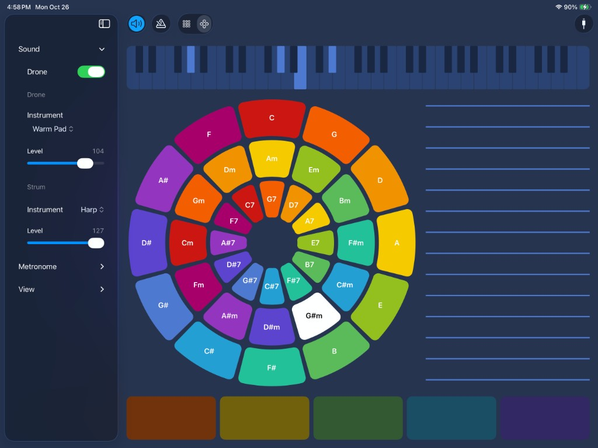
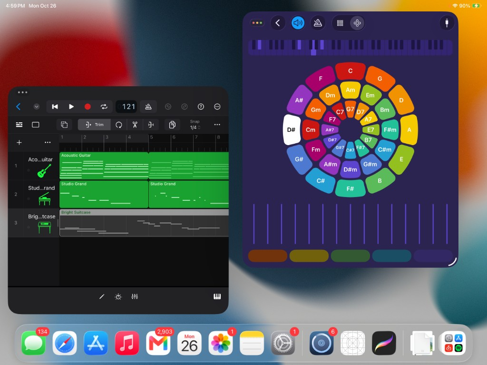

# AutoHarp

Strummable circle of fifths

Tap a chord, strum the bar on the right, leave a drone going if you want one. MIDI goes out to whatever destination you pick, so it also works next to GarageBand.

Open `AutoHarp.xcodeproj` and run it on an iPad.

